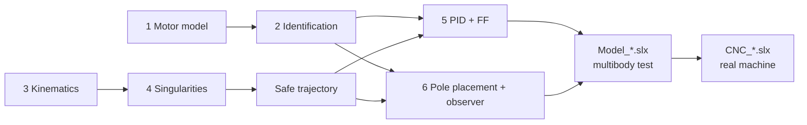

# CNC Machine Control - Coupled MIMO System

Control of the **Quanser CNC plotter**: two SRV02 rotary servos (motors `3165` and `3166`) drive a **five-bar parallel linkage**, and the end-effector point **C** has to track a trajectory in the plane.
The real plant runs with **QUARC** (Q2-USB data acquisition + VoltPAQ-X2 amplifier); every controller is first tested on a **Simscape Multibody** model built from the Fusion 360 CAD.

---

## Lab roadmap

Follow the steps in order, or jump straight to the one you need.

| # | Step | What we do | Techniques | Go to |
|:-:|------|------------|------------|:-----:|
| 1 | **Motor model** | Physical model of motor + gearbox, check if the inductance matters | First-principles modelling, pole analysis, Bode | [→](#1-motor-model) |
| 2 | **Identification** | Estimate gain and time constant of each motor, without and with the linkage | Periodic multisine, grey-box `procest`, FFT-based FRF | [→](#2-model-identification) |
| 3 | **Kinematics** | Map joint angles $(\varphi,\theta)$ ↔ pen position $(x_C,y_C)$ | Closed-form FK, symbolic Jacobian, numerical IK | [→](#3-kinematics) |
| 4 | **Singularities** | Find the forbidden configurations and the safe angle range | Constraint Jacobians $J_x$, $J_q$, contour extraction | [→](#4-singularities-and-safe-workspace) |
| 5 | **PID + feedforward** | Joint-space position control of both motors | `pidtune` loop shaping, inverse-model feedforward | [→](#5-pid-control-and-feedforward) |
| 6 | **Pole placement + observer** | State feedback with integral action and estimated speed | *Work in progress* | [→](#6-pole-placement-and-observer) |
| 7 | **Simulink models** | Run on the multibody model, then on the real machine | QUARC, Simscape Multibody | [→](#7-simulink-models) |



---

## Repository structure

```text
matlab/
├── README.md
├── .gitignore
├── data/                          # experiments (rows: t, V, theta_deg)
│   ├── data_<motor>_seed<N>.mat       # motor alone (no load)
│   ├── data_<motor>_seed<N>_load.mat  # five-bar attached
│   └── multisine_design.mat           # created by multisine_design.m
├── scripts/
│   ├── parameters.m               # ALL static constants (datasheet + identified k, tau)
│   ├── link.step                  # CAD of one link (used by Model_*.slx)
│   ├── model_id/                  # modelling and identification
│   │   ├── actuator_model.m           # step 1: physical motor model
│   │   ├── multisine_design.m         # step 2: excitation signal
│   │   ├── identification.m           # step 2: estimation + validation
│   │   ├── kinematics.m               # step 3: FK, Jacobian, IK (generates FK_classic.m, J_classic.m)
│   │   └── singularities_plot.m       # step 4: singularity curves
│   ├── control/
│   │   ├── pid.m                      # step 5: PID design + workspace loader
│   │   └── pole_placement.m           # step 6: state feedback + observer (WIP)
│   └── plot/
│       └── plotter.m                  # desired vs real/simulated trajectory
└── slx/
    ├── CNC_pid_ff.slx             # real machine, PID + feedforward
    ├── CNC_pp_obs.slx             # real machine, pole placement + observer
    ├── Model_pid_ff.slx           # multibody model, PID + feedforward
    └── Model_pp_obs.slx           # multibody model, pole placement + observer
```

## Quick start

> [!IMPORTANT]
> Paths are relative: **run every script from its own folder** (accept *Change Folder* when MATLAB asks).

1. `scripts/model_id/kinematics.m` → generates `FK_classic.m` and `J_classic.m` (git-ignored).
2. `scripts/model_id/multisine_design.m` → creates `data/multisine_design.mat` (needed by `identification.m` and by the `InitFcn` callback of `CNC_pid_ff.slx`).
3. Load the workspace for the model you want to run:

| Model | Run before |
|-------|-----------|
| `CNC_pid_ff.slx`, `Model_pid_ff.slx` | `scripts/control/pid.m` |
| `CNC_pp_obs.slx`, `Model_pp_obs.slx` | `scripts/control/pole_placement.m` (calls `pid.m` itself) |

4. After an experiment: `scripts/plot/plotter.m`.

> [!NOTE]
> The analysis scripts (`actuator_model`, `identification`, `kinematics`, `singularities_plot`) start with `clear`: run them on their own, then re-run `pid.m` before simulating.
> `Model_*.slx` load `link.step` from an absolute path (`C:\Users\ricca\...\scripts\link.step`): on another PC re-point the *File Solid* blocks.

---

## 1. Motor model

`scripts/model_id/actuator_model.m`

Each joint is a DC motor with a gearbox (SRV02, high gear). Input: armature voltage $V$, output: load angle $\theta$.

$$
\underbrace{L_m \dot I + R_m I = V - K_g k_m \omega}_{\text{electrical}}
\qquad
\underbrace{J_{eq}\dot\omega + \beta_{eq}\,\omega = \eta K_g k_t I}_{\text{mechanical}},
\qquad \eta = \eta_m\eta_g
$$

The electrical pole $R_m/L_m \approx 14\,400$ rad/s is ~350 times faster than the mechanical one (~40 rad/s), so $L_m$ is neglected. The Bode plot of the two models overlaps far beyond the control bandwidth. The selected model is

$$
G(s)=\frac{\theta(s)}{V(s)}=\frac{K}{s(\tau s+1)},\qquad
K=\frac{\eta K_g k_t}{R_m\beta_{eq}+\eta k_t k_m K_g^2},\qquad
\tau=\frac{R_m J_{eq}}{R_m\beta_{eq}+\eta k_t k_m K_g^2}
$$

From the datasheet: $K \approx 1.53$ rad/(V·s), $\tau \approx 24.8$ ms. The back-EMF moves the mechanical pole from ~7 rad/s to ~40 rad/s.

[↑ back to roadmap](#lab-roadmap)

---

## 2. Model identification

`scripts/model_id/multisine_design.m` → `scripts/model_id/identification.m`

The structure of $G(s)$ is known, so only $K$ and $\tau$ are estimated (grey-box, `procest` with the `P1I` structure = integrator + first-order pole).

**Excitation: periodic multisine**

| Choice | Value | Why |
|--------|-------|-----|
| Period | $T_p = 8$ s, $T_s = 2$ ms | frequency grid $2\pi/T_p$: each sine falls exactly on an FFT bin (no leakage) |
| Frequencies | 10 harmonics, ~5.5 → 51 rad/s | cover the mechanical pole and the future control band |
| Harmonic indices | odd, not multiples of each other | harmonics generated by nonlinearities (friction, backlash) do not fall on excited bins |
| Amplitudes | 0.4 → 1.5 V, increasing with $\omega$ | compensate the $1/\omega^2$ roll-off of $G$, uniform SNR |
| Phases | random, `seed = 30` estimation, `seed = 29` validation | low crest factor; validation uses the same frequencies with different phases |
| Periods | 6, first one discarded | transient removed, remaining periods averaged |

The signal has zero mean over a period, so the angle oscillates around its start instead of drifting away.

**No load first, then load.** The excitation was first applied to the motors alone, to check the angle excursion and the voltage levels without risk. Since the excursion stayed small, the **same signal** was applied with the five-bar attached, without risk of hitting a singularity or breaking the linkage.

**Validation.** Time domain: `compare` on the other seed. Frequency domain: measured FRF $Y(k)/U(k)$ at the excited bins (averaged over periods, linear drift removed) vs identified and datasheet Bode.

| Motor | Condition | $k$ [rad/(V·s)] | $\tau$ [ms] | Pole $1/\tau$ [rad/s] |
|:-----:|:---------:|:---------------:|:-----------:|:--------------------:|
| 3165 | no load | 1.60 | 20.6 | 48.5 |
| 3166 | no load | 1.53 | 21.8 | 45.8 |
| 3165 | load | 1.44 | 37.4 | 26.7 |
| 3166 | load | 1.38 | 38.1 | 26.2 |

With the linkage the time constant almost doubles (added inertia) and the gain drops by ~10 % (added friction). **The control design uses the `load` models.** Values are stored in `scripts/parameters.m`.

[↑ back to roadmap](#lab-roadmap)

---

## 3. Kinematics

`scripts/model_id/kinematics.m`

<details>
<summary><b>Mobility</b> (click to expand)</summary>

4 moving links × 3 DoF = 12, minus 5 revolute joints × 2 constraints = 10 → **2 DoF**, one per motor.
</details>

Geometry (all links of length $l = 0.127$ m), $A=(0,0)$, $E=(2l,0)$:

$$
B = l\begin{bmatrix}\cos\varphi\\ \sin\varphi\end{bmatrix},\qquad
D = \begin{bmatrix}2l - l\sin\theta\\ l\cos\theta\end{bmatrix}
$$

**Forward kinematics** (derived by hand, then checked symbolically). $C$ is the intersection of two circles of radius $l$ centred in $B$ and $D$: midpoint of $BD$ plus a perpendicular offset $h$.

$$
a = 2-\sin\theta-\cos\varphi,\quad b=\cos\theta-\sin\varphi,\quad s=\sqrt{a^2+b^2},\quad h=l\sqrt{1-s^2/4}
$$
$$
x_C=\tfrac{l}{2}(2-\sin\theta+\cos\varphi)-\tfrac{h\,b}{s},\qquad
y_C=\tfrac{l}{2}(\cos\theta+\sin\varphi)+\tfrac{h\,a}{s}
$$

**Home** $\varphi=\theta=0$ → $C=(l,l)$ and

$$
J_{home}= l\begin{bmatrix}0&-1\\1&0\end{bmatrix}
\;\Rightarrow\; \delta y_C \approx l\,\delta\varphi,\quad \delta x_C\approx -l\,\delta\theta
$$

so near home the axes are almost decoupled: $\varphi$ moves $y$, $\theta$ moves $x$.

**Inverse kinematics** is solved numerically: `fsolve` in the script, damped Newton warm-started from the previous sample inside Simulink (always on the same assembly mode). Joint velocity and acceleration for the feedforward:

$$
\dot q = J^{-1}\dot p,\qquad \ddot q = J^{-1}(\ddot p - \dot J\dot q)
$$

[↑ back to roadmap](#lab-roadmap)

---

## 4. Singularities and safe workspace

`scripts/model_id/singularities_plot.m` (needs `FK_classic.m`)

Differentiating the loop constraints $|C-B| = l$, $|C-D| = l$:

$$
J_x\,\dot C = J_q\,\dot q,\qquad
J_x=\begin{bmatrix}(C-B)^T\\(C-D)^T\end{bmatrix},\qquad
J_q=\mathrm{diag}\!\left((C-B)^T\tfrac{\partial B}{\partial\varphi},\;(C-D)^T\tfrac{\partial D}{\partial\theta}\right)
$$

| Type | Condition | Meaning | Plot colour |
|------|-----------|---------|:-----------:|
| Serial left | $J_q(1,1)=0$ | $BC$ aligned with $AB$: C loses a direction | blue |
| Serial right | $J_q(2,2)=0$ | $DC$ aligned with $ED$ | green |
| Parallel | $\det J_x = 0$, $B\neq D$ | $B, C, D$ aligned ($\lvert BD\rvert=2l$): C moves with locked motors, uncontrollable | red |
| Degenerate | $B = D$ ($\varphi=0,\ \theta=\pi/2$) | C free to rotate around $B=D$ | cyan |

The FK Jacobian alone is not enough: $\det J = \det J_q / \det J_x$ vanishes only at the serial singularities and blows up at the parallel ones, so both matrices are evaluated on a $601\times601$ grid and their zero-level contours are drawn in **joint space** and mapped to **Cartesian space**.

**Result.** The square trajectory used in the models (centre $(l,l)$, side 9 cm) needs $\varphi,\theta \in [-21°, +28°]$, and along it all the normalised singularity factors stay ≥ 0.55 (they equal 1 at home). Home is the best-conditioned pose, so trajectories are centred on it.

[↑ back to roadmap](#lab-roadmap)

---

## 5. PID control and feedforward

`scripts/control/pid.m`: loads `parameters.m`, designs one PID per motor and leaves in the workspace everything the `*_pid_ff.slx` models need.

Plant: the `load` model in encoder degrees, $G(s)=-\frac{180}{\pi}\frac{k}{s(\tau s+1)}$ (the minus sign is the encoder convention).

| `pidtune` option | Value | Reason |
|-------|-------|--------|
| `CrossoverFrequency` | 20 rad/s | below the mechanical pole (~26 rad/s) and inside the identified band, where the model is trusted; keeps $V$ away from the ±6 V saturation |
| `PhaseMargin` | 90° | no overshoot: an overshoot on one joint becomes a path error at the corners |
| `DesignFocus` | `reference-tracking` | the goal is following $q_{ref}(t)$, the disturbances (friction) are small |
| Same specs on both motors | — | equal closed-loop dynamics on both joints, so the coupled linkage does not distort the shape in the plane |

The plant already has an integrator, so with the I action the loop is type 2: zero steady-state error on ramps.
In Simulink the derivative is filtered with $N=100$ rad/s (5× the crossover).

**Feedforward.** The trajectory is known in advance and smooth (quintic time scaling → continuous velocity and acceleration), so the inverse model gives the voltage needed to follow it:

$$
\tau\ddot\theta + \dot\theta = k\,u \;\Rightarrow\; u_{ff} = \frac{\tau}{k}\ddot q_d + \frac{1}{k}\dot q_d
$$

$\dot q_d$, $\ddot q_d$ come from the IK block. The feedforward supplies most of the voltage, the PID only corrects model errors; it removes the tracking lag of feedback-only control and, being outside the loop, does not change stability.

[↑ back to roadmap](#lab-roadmap)

---

## 6. Pole placement and observer

`scripts/control/pole_placement.m`

> 🚧 *Work in progress: we are still studying how to choose the poles.*

[↑ back to roadmap](#lab-roadmap)

---

## 7. Simulink models

Naming: **prefix = target**, **suffix = control technique**.

| Prefix | Target | Description |
|--------|--------|-------------|
| `CNC_*` | Real machine | QUARC external mode, encoders (4096 counts/rev) and analog outputs of the Q2-USB |
| `Model_*` | Simulation | Simscape Multibody model of the five-bar imported from Fusion 360, driven by the identified motor models: used to test every controller **before** the real machine |

| Suffix | Controller |
|--------|-----------|
| `_pid_ff` | PID + inverse-model feedforward ([section 5](#5-pid-control-and-feedforward)) |
| `_pp_obs` | Pole placement + observer ([section 6](#6-pole-placement-and-observer)) |

All models share the same chain: **trajectory generator** (smooth square, period 4 s) → **IK block** ($q_d$, $\dot q_d$, $\ddot q_d$) → **controller** → saturation ±6 V → plant → **FK block** ($x_C$, $y_C$ logged for `plotter.m`).

[↑ back to roadmap](#lab-roadmap)

---

## Authors

- Riccardo Serraino — [GitHub](https://github.com/riccardoserraino) | [LinkedIn](https://www.linkedin.com/in/riccardoserraino/)
- Giuliano Livi — [GitHub](https://github.com/Giuliano-Livi) | [LinkedIn](https://www.linkedin.com/in/giuliano-livi-524a81335/)
- Enrico Castelli — [GitHub](https://github.com/chettante) | [LinkedIn](https://www.linkedin.com/in/enrico-castelli-4a3b16323/)
- Matteo Giovanelli — [GitHub](https://github.com/mattigiova22) | [LinkedIn](https://www.linkedin.com/in/matteo-giovanelli-4a0029230/)
