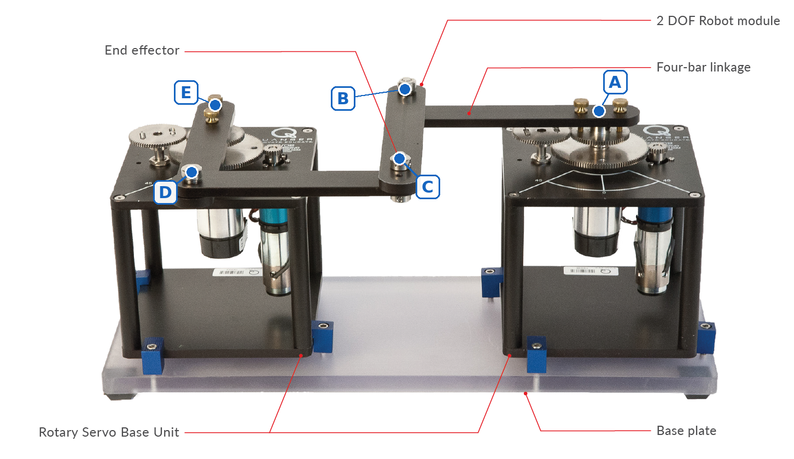
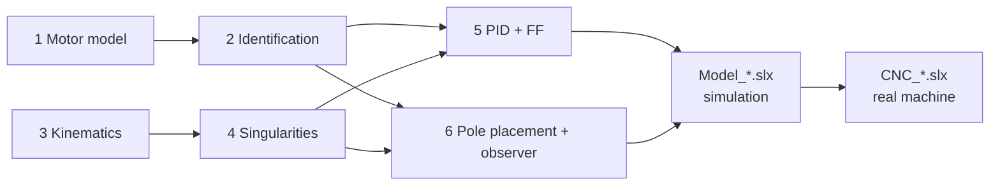
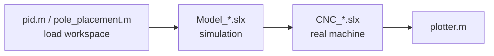

# 2DOF Robot Control - Coupled MIMO System

Control of the **2 DOF Robot** by *Quanser*, emulating a CNC Machine: two rotary servos drive a **four-bar linkage**, and the end-effector point **C** has to track a trajectory in the plane.
The two motors are coupled through the linkage, so the system is MIMO. Every controller is first tested on a **Simscape Multibody** model and then run on the real machine with **QUARC**.

<p align="center">
  
  <br/><sub>Home configuration (image: Quanser CNC documentation).</sub>
</p>

---

## Lab roadmap

Follow the steps in order, or jump to the one you need.

| # | Step | Goal | Techniques | Go to |
|:-:|------|------|------------|:-----:|
| 1 | **Motor model** | Choose the model structure of each joint | First-principles modelling | [→](#1-motor-model) |
| 2 | **Identification** | Estimate the model parameters on the real motors | Periodic multisine, grey-box estimation | [→](#2-model-identification) |
| 3 | **Kinematics** | Link joint angles and pen position | Closed-form FK, Jacobian, numerical IK | [→](#3-kinematics) |
| 4 | **Singularities** | Find the safe range of angles | Constraint Jacobians | [→](#4-singularities-and-safe-workspace) |
| 5 | **PID + feedforward** | Track the trajectory in joint space | Loop shaping, inverse-model feedforward | [→](#5-pid-control-and-feedforward) |
| 6 | **Pole placement + observer** | State feedback with estimated speed | *Work in progress* | [→](#6-pole-placement-and-observer) |
| 7 | **Simulink models** | Test in simulation, then on the machine | Simscape Multibody, QUARC | [→](#7-simulink-models) |



---

## Repository structure

```text
matlab/
├── README.md
├── .gitignore
├── data/                          # identification experiments
│   ├── data_<motor>_seed<N>.mat       # motor alone
│   ├── data_<motor>_seed<N>_load.mat  # linkage attached
│   └── multisine_design.mat           # created by multisine_design.m
├── scripts/
│   ├── parameters.m               # all static constants (datasheet + identified models)
│   ├── link.step                  # CAD of one link (used by Model_*.slx)
│   ├── model_id/
│   │   ├── actuator_model.m           # step 1
│   │   ├── multisine_design.m         # step 2
│   │   ├── identification.m           # step 2
│   │   ├── kinematics.m               # step 3 (generates FK_classic.m, J_classic.m)
│   │   └── singularities_plot.m       # step 4
│   ├── control/
│   │   ├── pid.m                      # step 5, creates the Simulink variables
│   │   └── pole_placement.m           # step 6 (WIP), creates the Simulink variables
│   └── plot/
│       └── plotter.m                  # desired vs real/simulated trajectory
├── slx/
│   ├── CNC_pid_ff.slx             # real machine
│   ├── CNC_pp_obs.slx
│   ├── Model_pid_ff.slx           # multibody simulation
│   └── Model_pp_obs.slx
└── docs/img/                      # README images
```

## Quick start

The workflow is always **simulation first, real machine after**:



- **`pid.m`** and **`pole_placement.m`** are the only scripts needed to simulate: they load `parameters.m` and create every variable used by the Simulink models (`pid.m` → `*_pid_ff.slx`, `pole_placement.m` → `*_pp_obs.slx`).
- All the other scripts (`model_id/`, `plot/`) are for theoretical checks, model identification and plotting.

> [!IMPORTANT]
> Run every script from its own folder (paths are relative). `CNC_pid_ff.slx` loads `data/multisine_design.mat` at start-up: run `multisine_design.m` once if the file is missing.

---

## 1. Motor model

`actuator_model.m`

Each joint is a DC motor with a gearbox. The electrical and mechanical equations are coupled through the torque and the back-EMF:

$$
L_m \dot I + R_m I = V - K_g k_m\,\omega \qquad\qquad J_{eq}\,\dot\omega + \beta_{eq}\,\omega = \eta\, K_g k_t\, I
$$

The electrical pole $R_m/L_m$ is a few hundred times faster than the mechanical one, so $L_m$ is neglected (the Bode plots of the two models overlap well beyond the control band). The model from voltage to angle becomes:

$$
G(s)=\frac{\theta(s)}{V(s)}=\frac{k}{s(\tau s+1)},\qquad
k=\frac{\eta K_g k_t}{R_m\beta_{eq}+\eta k_t k_m K_g^2},\qquad
\tau=\frac{R_m J_{eq}}{R_m\beta_{eq}+\eta k_t k_m K_g^2}
$$

an integrator plus one mechanical pole: only $k$ and $\tau$ have to be identified.

[↑ back to roadmap](#lab-roadmap)

---

## 2. Model identification

`multisine_design.m` → `identification.m`

The structure of $G(s)$ is known, so $k$ and $\tau$ are estimated with a **grey-box** fit (`procest`, integrator + one pole) on one experiment and validated on another.

The input is a **periodic multisine**, a sum of sines repeated over several periods. It excites the whole band of interest in one experiment, and since every sine is exactly periodic, the frequency response is read directly from the FFT and averaged over the periods. Harmonics, amplitudes and random phases are chosen to avoid nonlinear distortion, compensate the motor roll-off and keep the peak voltage low.

The test was first run on the **motors alone**, to check voltages and angle excursion safely, then repeated with the **same signal** and the **linkage attached**. The models identified with the load are the ones used for control.

[↑ back to roadmap](#lab-roadmap)

---

## 3. Kinematics

`kinematics.m`

The linkage has two degrees of freedom, one per motor. With **A** at the origin and **E** at $(2l, 0)$, the motors set the positions of the two elbows **B** and **D**:

$$
B = l\begin{bmatrix}\cos\varphi\\ \sin\varphi\end{bmatrix},\qquad
D = \begin{bmatrix}2l - l\sin\theta\\ l\cos\theta\end{bmatrix}
$$

The pen **C** is at distance $l$ from both, so it lies at the intersection of two circles: the midpoint of $BD$ moved by $h = l\sqrt{1-|BD|^2/(4l^2)}$ along the perpendicular to $BD$. This gives a closed-form **forward kinematics** $p_C = f(\varphi,\theta)$, derived by hand and checked symbolically.

- **Jacobian** $J = \partial p_C/\partial q$: computed symbolically and exported as a function.
- **Home pose** ($\varphi=\theta=0$): the linkage is a square, and near it the axes are almost decoupled ($\varphi$ moves $y$, $\theta$ moves $x$).
- **Inverse kinematics**: solved numerically (Newton iterations starting from the previous sample, so the solution stays on the same assembly mode). Velocities and accelerations for the feedforward come from $\dot q = J^{-1}\dot p$ and $\ddot q = J^{-1}(\ddot p - \dot J\dot q)$.

[↑ back to roadmap](#lab-roadmap)

---

## 4. Singularities and safe workspace

`singularities_plot.m` (run `kinematics.m` first)

Differentiating the loop constraints $|C-B| = |C-D| = l$ gives:

$$
J_x\,\dot p_C = J_q\,\dot q,\qquad
J_x=\begin{bmatrix}(C-B)^T\\(C-D)^T\end{bmatrix},\qquad
J_q=\begin{bmatrix}(C-B)^T\frac{\partial B}{\partial\varphi} & 0\\ 0 & (C-D)^T\frac{\partial D}{\partial\theta}\end{bmatrix}
$$

| Type | Condition | Physical meaning |
|------|-----------|------------------|
| **Serial** | $\det J_q = 0$ | one arm fully stretched or folded: the pen cannot move in some direction |
| **Parallel** | $\det J_x = 0$, $B \neq D$ | B, C, D aligned: the pen can move with the motors locked (uncontrollable) |
| **Degenerate** | $B = D$ | the position of C is undetermined |

The FK Jacobian $J = J_x^{-1}J_q$ alone is not enough: its determinant vanishes at serial singularities and blows up at parallel ones. Both conditions are therefore evaluated on a grid of angles and drawn in **joint space** (angles to avoid) and **Cartesian space** (positions to avoid). Home is the best-conditioned pose, so trajectories are centred on it and kept inside the region bounded by the singularity curves.

[↑ back to roadmap](#lab-roadmap)

---

## 5. PID control and feedforward

`pid.m`

**Step 1: PID.** One PID per motor is tuned with `pidtune` on the identified load model:
- **crossover below the mechanical pole**, inside the identified band: the controller acts only where the model is reliable, and the voltage stays far from saturation;
- **90° phase margin**: no overshoot, which would show up as a path error at the corners;
- **reference-tracking focus**, and **the same specifications on both motors**: both joints get the same closed-loop dynamics, so the coupled linkage does not distort the shape.

The plant already has an integrator, so with the integral action the loop also follows ramps with zero steady-state error. Faster references, however, are still tracked with a lag.

**Step 2: feedforward.** To improve tracking, a feedforward term was added. The trajectory is known in advance and smooth, so inverting the motor model gives the voltage needed to follow it:

$$
\tau\ddot\theta + \dot\theta = k\,u \;\;\Rightarrow\;\; u = \underbrace{\frac{\tau}{k}\ddot q_d + \frac{1}{k}\dot q_d}_{u_{ff}} + u_{PID}
$$

The feedforward supplies most of the input, and the PID only corrects model errors and disturbances. This removes most of the lag, and since the feedforward is outside the loop it does not change stability.

[↑ back to roadmap](#lab-roadmap)

---

## 6. Pole placement and observer

`pole_placement.m`

> 🚧 *Work in progress: we are still studying how to choose the poles.*

[↑ back to roadmap](#lab-roadmap)

---

## 7. Simulink models

Naming: **prefix = target**, **suffix = control technique**.

| | `_pid_ff` (PID + feedforward) | `_pp_obs` (pole placement + observer) |
|---|:---:|:---:|
| **`CNC_*`**: real machine (QUARC) | `CNC_pid_ff.slx` | `CNC_pp_obs.slx` |
| **`Model_*`**: simulation | `Model_pid_ff.slx` | `Model_pp_obs.slx` |

- **`CNC_*`** run on the real plotter: encoders in, motor voltages out.
- **`Model_*`** test the controllers in advance on a **Simscape Multibody** model of the linkage, built from the Fusion 360 CAD and driven by the identified motor models.

Every model shares the same chain: trajectory generator → inverse kinematics → controller → saturation → plant → forward kinematics (pen position logged for `plotter.m`).

> [!WARNING]
> **Multibody link geometry path.** In both `Model_*.slx`, the blocks **Link 1, Link 2, Link 3, Link 4** inside the **Mechanical kinematics** subsystem load `scripts/link.step` from an **absolute path** set on the author's PC. After cloning, open each of the four blocks and set its geometry file to the `link.step` on your machine, otherwise the model will not compile.

[↑ back to roadmap](#lab-roadmap)

---

## Authors

- Riccardo Serraino — [GitHub](https://github.com/riccardoserraino) | [LinkedIn](https://www.linkedin.com/in/riccardoserraino/)
- Giuliano Livi — [GitHub](https://github.com/Giuliano-Livi) | [LinkedIn](https://www.linkedin.com/in/giuliano-livi-524a81335/)
- Enrico Castelli — [GitHub](https://github.com/chettante) | [LinkedIn](https://www.linkedin.com/in/enrico-castelli-4a3b16323/)
- Matteo Giovanelli — [GitHub](https://github.com/mattigiova22) | [LinkedIn](https://www.linkedin.com/in/matteo-giovanelli-4a0029230/)