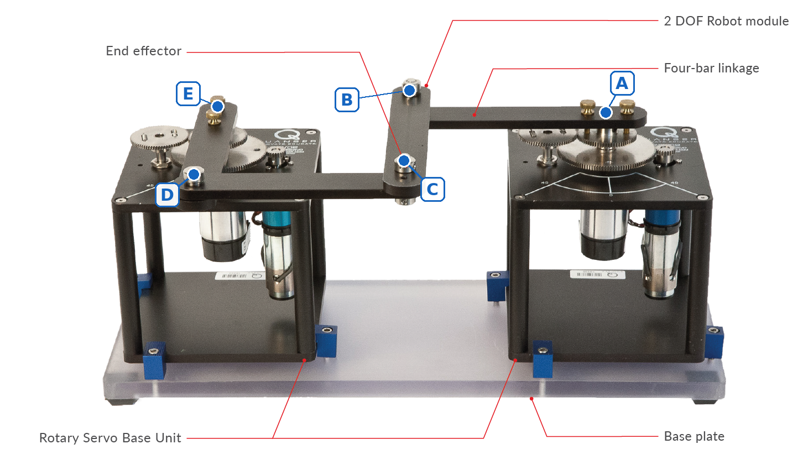
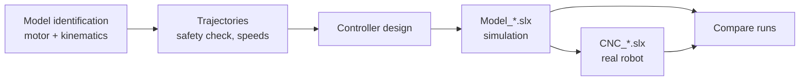

# 2DOF Robot Control - Coupled MIMO System

Control of the **2 DOF Robot** by *Quanser*, emulating a CNC machine: two rotary servos drive a
**four-bar linkage**, and the pen (point **C**) has to follow a path in the plane.
The two motors are coupled through the linkage, so the system is MIMO.

<p align="center">
  
  <br/><sub>Home configuration (image: Quanser CNC documentation).</sub>
</p>

We built a **Simulink model of the machine** (Simscape Multibody linkage from the CAD, driven
by the identified motor models with friction and delay) to test every controller **offline** and
check how it works in simulation before running it on the real robot with **QUARC**.

## Workflow



| step | what | details |
|---|---|---|
| 1 | Motor model, identification, kinematics, singularities, friction | [model_id/README](scripts/model_id/README.md) |
| 2 | Paths, joint safety check, speed levels for benchmarking | [trajectory/README](scripts/trajectory/README.md) |
| 3 | Controllers: PID + feedforward, pole placement + observer, ... | [scripts/README](scripts/README.md#controllers) |
| 4 | Simulation, then the real robot | `slx/` (below) |
| 5 | Saving runs and comparing controllers | [plot/README](scripts/plot/README.md) |

Start from the [scripts README](scripts/README.md) for the overall workflow.

## Repository structure

```text
matlab/
├── data/        identification experiments (id/), simulation runs (sim/), robot runs (lab/)
├── docs/img/    README images
├── scripts/     parameters.m, model_id/, trajectory/, control/, plot/, run_and_save.m
└── slx/         Simulink models
```

| | simulation | real robot (QUARC) |
|---|:---:|:---:|
| PID + feedforward | `Model_pid_ff.slx` | `CNC_pid_ff.slx` |
| Pole placement + observer | `Model_pp_obs.slx` | `CNC_pp_obs.slx` |

> [!IMPORTANT]
> Paths are relative: run `check_trajectory.m` from the repository root (`matlab/`) and the
> `model_id/` scripts from their own folder (see the [scripts README](scripts/README.md)).
> `CNC_pid_ff.slx` loads `data/multisine_design.mat` at start-up: run
> `scripts/model_id/multisine_design.m` once if the file is missing.

> [!WARNING]
> **Multibody link geometry path.** In both `Model_*.slx`, the blocks **Link 1-4** inside the
> **Mechanical kinematics** subsystem load `scripts/link.step` from an **absolute path** set on
> the author's PC. After cloning, open each of the four blocks and set its geometry file to the
> `link.step` on your machine, otherwise the model will not compile.

## Authors

- Riccardo Serraino — [GitHub](https://github.com/riccardoserraino) | [LinkedIn](https://www.linkedin.com/in/riccardoserraino/)
- Giuliano Livi — [GitHub](https://github.com/Giuliano-Livi) | [LinkedIn](https://www.linkedin.com/in/giuliano-livi-524a81335/)
- Enrico Castelli — [GitHub](https://github.com/chettante) | [LinkedIn](https://www.linkedin.com/in/enrico-castelli-4a3b16323/)
- Matteo Giovanelli — [GitHub](https://github.com/mattigiova22) | [LinkedIn](https://www.linkedin.com/in/matteo-giovanelli-4a0029230/)
