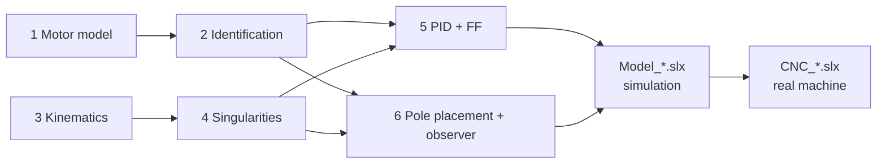

# CNC Machine Control - Coupled MIMO System

Control of the **Quanser CNC plotter**: two rotary servos drive a **four-bar linkage**, and the end-effector point **C** has to track a trajectory in the plane.
The two motors are coupled through the linkage, so the system is MIMO. Every controller is first tested on a **Simscape Multibody** model and then run on the real machine with **QUARC**.

---

## Lab roadmap

Follow the steps in order, or jump to the one you need.

| # | Step | Goal | Techniques | Go to |
|:-:|------|------|------------|:-----:|
| 1 | **Motor model** | Choose the model structure of each joint | First-principles modelling | [→](#1-motor-model) |
| 2 | **Identification** | Estimate the model parameters on the real motors | Periodic multisine, grey-box estimation | [→](#2-model-identification) |
| 3 | **Kinematics** | Link joint angles and pen position | Closed-form FK, Jacobian, numerical IK | [→](#3-kinematics) |
| 4 | **Singularities** | Find the safe range of angles | Constraint Jacobians | [→](#4-singularities) |
| 5 | **PID + feedforward** | Track the trajectory in joint space | Loop shaping, inverse-model feedforward | [→](#5-pid-control-and-feedforward) |
| 6 | **Pole placement + observer** | State feedback with estimated speed | *Work in progress* | [→](#6-pole-placement-and-observer) |
| 7 | **Simulink models** | Test in simulation, then on the machine | Simscape Multibody, QUARC | [→](#7-simulink-models) |



---

## Repository structure

```text
matlab/
├── README.md
├── .gitignore
├── data/                          # identification experiments
│   ├── data_<motor>_seed<N>.mat       # motor alone
│   ├── data_<motor>_seed<N>_load.mat  # linkage attached
│   └── multisine_design.mat           # created by multisine_design.m
├── scripts/
│   ├── parameters.m               # all static constants (datasheet + identified models)
│   ├── link.step                  # CAD of one link (used by Model_*.slx)
│   ├── model_id/
│   │   ├── actuator_model.m           # step 1
│   │   ├── multisine_design.m         # step 2
│   │   ├── identification.m           # step 2
│   │   ├── kinematics.m               # step 3 (generates FK_classic.m, J_classic.m)
│   │   └── singularities_plot.m       # step 4
│   ├── control/
│   │   ├── pid.m                      # step 5 + workspace loader
│   │   └── pole_placement.m           # step 6 (WIP)
│   └── plot/
│       └── plotter.m                  # desired vs real/simulated trajectory
└── slx/
    ├── CNC_pid_ff.slx    ├── Model_pid_ff.slx
    └── CNC_pp_obs.slx    └── Model_pp_obs.slx
```

## Quick start

> [!IMPORTANT]
> Paths are relative: **run every script from its own folder** (accept *Change Folder* when MATLAB asks).

1. Run `kinematics.m` once: it generates `FK_classic.m` and `J_classic.m` (not committed).
2. Run `multisine_design.m` once: it creates `data/multisine_design.mat`, needed by `identification.m` and by `CNC_pid_ff.slx`.
3. Load the workspace, then open the model:

| Model | Run before |
|-------|-----------|
| `*_pid_ff.slx` | `scripts/control/pid.m` |
| `*_pp_obs.slx` | `scripts/control/pole_placement.m` (calls `pid.m` itself) |

4. After a run, `plotter.m` compares desired and obtained trajectory.

> [!NOTE]
> The analysis scripts in `model_id/` start with `clear`: run them on their own, then re-run `pid.m` before simulating.

---

## 1. Motor model

`actuator_model.m`

Each joint is a DC motor with a gearbox. Writing the electrical and mechanical equations (with the back-EMF closing a loop between them) gives a third-order model from voltage to angle.
The electrical pole is a few hundred times faster than the mechanical one, so the inductance can be neglected. The Bode plots of the full and simplified models overlap well beyond the control band, which leaves:

$$
G(s)=\frac{\theta(s)}{V(s)}=\frac{k}{s(\tau s+1)}
$$

an integrator (voltage → speed → angle) plus one mechanical pole. Only $k$ and $\tau$ need to be identified.

[↑ back to roadmap](#lab-roadmap)

---

## 2. Model identification

`multisine_design.m` → `identification.m`

Since the structure of $G(s)$ is known, a **grey-box** estimate is enough (`procest` with an integrator + one pole). One experiment is used for estimation, a different one for validation.

**Why a periodic multisine.** The input is a sum of sines, repeated over several periods:
- it excites many frequencies at once, around the mechanical pole and the future control band;
- each sine is exactly periodic in the record, so its frequency falls on an FFT bin: the frequency response is measured directly, with no leakage, and averaging the periods reduces noise;
- the chosen harmonics avoid each other's multiples, so distortion from nonlinearities (friction, backlash) does not corrupt the measured points;
- amplitudes grow with frequency to compensate the roll-off of the motor;
- random phases keep the peak voltage low. Two seeds give two experiments with the same frequencies but different signals, one to estimate and one to validate.

The signal has zero mean over a period, so the angle oscillates around its start without drifting away.

**No load first, then load.** The excitation was first applied to the motors alone, to check voltage levels and angle excursion safely. Since the motion stayed small, **the same signal** was then applied with the linkage attached, without reaching a singularity or damaging the mechanism.

**Validation** is done in time (simulated vs measured angle on the validation experiment) and in frequency (measured FFT points vs Bode of the identified and datasheet models).
With the linkage attached, the time constant grows (more inertia) and the gain drops slightly (more friction). **The control design uses the models identified with the load.**

[↑ back to roadmap](#lab-roadmap)

---

## 3. Kinematics

`kinematics.m`

The linkage has two degrees of freedom, one per motor. The motors set the positions of the two elbows **B** and **D**. The pen **C** is at distance $l$ from both, so it is the intersection of two circles: the midpoint of $BD$ moved along the perpendicular to $BD$. This gives a closed-form **forward kinematics** $p_C = f(\varphi,\theta)$, derived by hand and checked symbolically.

- **Jacobian** $J = \partial p_C/\partial q$: computed symbolically and exported as a function.
- **Home pose** ($\varphi=\theta=0$): the linkage is a square, and near it the axes are almost decoupled ($\varphi$ moves $y$, $\theta$ moves $x$).
- **Inverse kinematics**: no simple closed form, so it is solved numerically. Inside Simulink, Newton iterations start from the previous sample, so the solution always stays on the same assembly mode.
- Joint velocity and acceleration for the feedforward come from $\dot q = J^{-1}\dot p$ and $\ddot q = J^{-1}(\ddot p - \dot J\dot q)$.

[↑ back to roadmap](#lab-roadmap)

---

## 4. Singularities

`singularities_plot.m` (needs `FK_classic.m`)

Differentiating the loop constraints ($|C-B| = |C-D| = l$) gives $J_x\,\dot p_C = J_q\,\dot q$. Each matrix shows one family of singularities:

| Type | Condition | Physical meaning |
|------|-----------|------------------|
| **Serial** | $\det J_q = 0$ | one arm fully stretched or folded: the pen cannot move in some direction |
| **Parallel** | $\det J_x = 0$ | B, C, D aligned: the pen can move with the motors locked, so it is uncontrollable |
| **Degenerate** | $B = D$ | the position of C is undetermined |

The FK Jacobian alone is not enough: it only vanishes at serial singularities and blows up at parallel ones. So both conditions are evaluated on a grid of angles and drawn as curves in **joint space** (which angles to avoid) and in **Cartesian space** (which pen positions to avoid).
Home is the best-conditioned pose, so trajectories are centred on it: the square used in the models stays well inside the safe region.

[↑ back to roadmap](#lab-roadmap)

---

## 5. PID control and feedforward

`pid.m` loads `parameters.m`, designs one PID per motor on the identified load model, and leaves in the workspace everything the `*_pid_ff.slx` models need.

**Why these `pidtune` specifications**
- **Crossover below the mechanical pole and inside the identified band**: the controller only acts where the model is reliable, and the voltage stays away from saturation.
- **90° phase margin**: no overshoot. An overshoot on one joint would show up as a path error at the corners.
- **Reference-tracking focus**: the goal is following a reference; disturbances are small.
- **Same specifications on both motors**: both joints get the same closed-loop dynamics, so the coupled linkage does not distort the shape in the plane.

The plant already contains an integrator, so with the integral action the loop also follows ramps with zero steady-state error.

**Feedforward.** The trajectory is known in advance and smooth, so inverting the motor model gives the voltage needed to follow it:

$$
u_{ff} = \frac{\tau}{k}\,\ddot q_d + \frac{1}{k}\,\dot q_d
$$

The feedforward supplies most of the input, and the PID only corrects model errors. This removes the delay of feedback-only control. Since the feedforward is outside the loop, it does not change stability.

[↑ back to roadmap](#lab-roadmap)

---

## 6. Pole placement and observer

`pole_placement.m`

> 🚧 *Work in progress: we are still studying how to choose the poles.*

[↑ back to roadmap](#lab-roadmap)

---

## 7. Simulink models

Naming: **prefix = target**, **suffix = control technique**.

| | `_pid_ff` (PID + feedforward) | `_pp_obs` (pole placement + observer) |
|---|:---:|:---:|
| **`CNC_*`**: real machine (QUARC) | `CNC_pid_ff.slx` | `CNC_pp_obs.slx` |
| **`Model_*`**: simulation | `Model_pid_ff.slx` | `Model_pp_obs.slx` |

- **`CNC_*`** run on the real plotter: encoders in, motor voltages out.
- **`Model_*`** test the controllers in advance on a **Simscape Multibody** model of the linkage, built from the Fusion 360 CAD and driven by the identified motor models.

Every model shares the same chain: trajectory generator → inverse kinematics → controller → saturation → plant → forward kinematics (pen position logged for `plotter.m`).

> [!WARNING]
> **Multibody link geometry path.** In both `Model_*.slx`, the blocks **Link 1, Link 2, Link 3, Link 4** inside the **Mechanical kinematics** subsystem load `scripts/link.step` from an **absolute path** set on the author's PC. After cloning, open each of the four blocks and set its geometry file to the `link.step` on your machine, otherwise the model will not compile.

[↑ back to roadmap](#lab-roadmap)

---

## Authors

- Riccardo Serraino — [GitHub](https://github.com/riccardoserraino) | [LinkedIn](https://www.linkedin.com/in/riccardoserraino/)
- Giuliano Livi — [GitHub](https://github.com/Giuliano-Livi) | [LinkedIn](https://www.linkedin.com/in/giuliano-livi-524a81335/)
- Enrico Castelli — [GitHub](https://github.com/chettante) | [LinkedIn](https://www.linkedin.com/in/enrico-castelli-4a3b16323/)
- Matteo Giovanelli — [GitHub](https://github.com/mattigiova22) | [LinkedIn](https://www.linkedin.com/in/matteo-giovanelli-4a0029230/)
