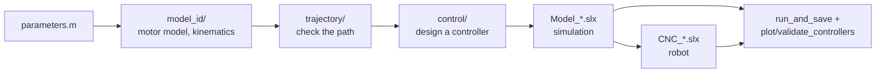

# Scripts

Where to run from: `trajectory/check_trajectory.m` from the **repository root** (`matlab/`),
the `model_id/` scripts from **their own folder**; the `control/` scripts work from anywhere.

## Workflow

1. **`parameters.m`**: every constant (datasheet, identified models, simulated plant).
2. **`model_id/`**: how the motor model and the kinematics were obtained → [README](model_id/README.md)
3. **`trajectory/`**: the paths, their safety check and the speed levels → [README](trajectory/README.md)
4. **`control/`**: one folder or script per controller (see below). Each one writes its gains
   to the workspace for the Simulink models.
5. **Simulate, then run on the robot**, save with `run_and_save` and compare with
   `plot/validate_controllers.m` → [README](plot/README.md)

## Controllers

| controller | where | README |
|---|---|---|
| PID + feedforward | `control/pid_tune.m` | *coming* |
| Pole placement + observer | `control/pp_design/` | [README](control/pp_design/README.md) |
| *next controllers (Kalman / LQG, MPC, ...)* | `control/<name>/` | *add a row here* |

Every controller follows the same pattern: a design script writes its variables to the
workspace, `Model_<name>.slx` tests it in simulation, `CNC_<name>.slx` runs it on the robot.
